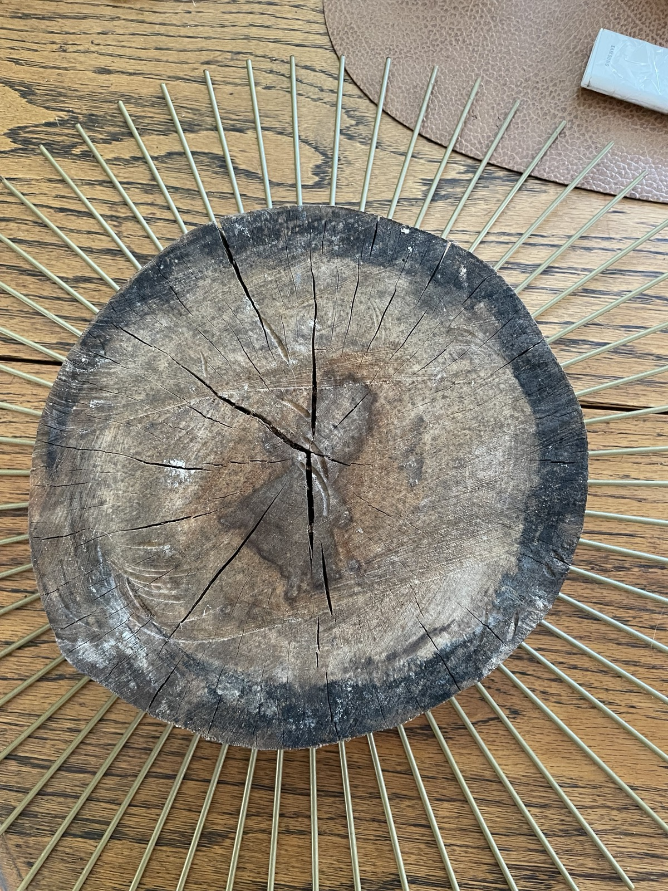
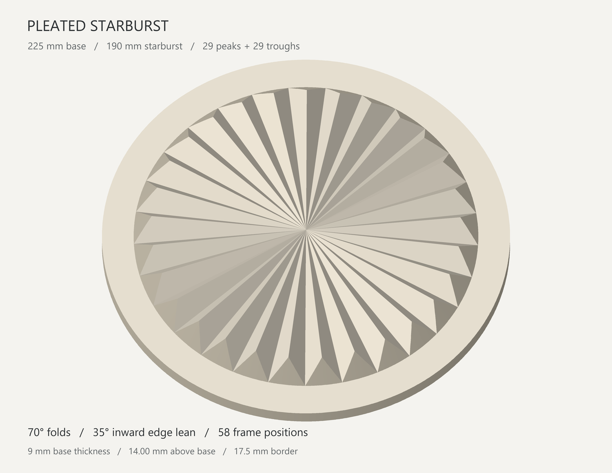
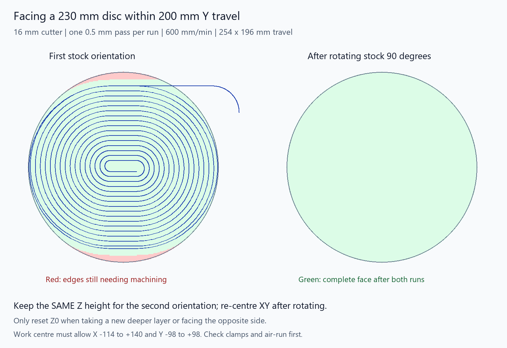
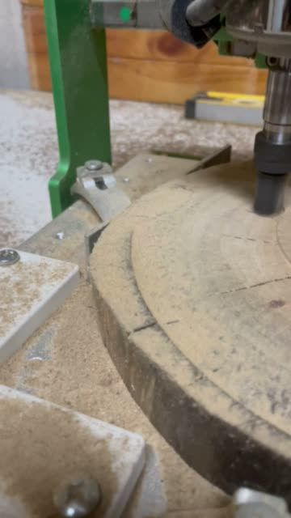

# Pleated starburst

A timber starburst insert for an existing metal frame with 58 rays. The relief has 29 peaks alternating with 29 troughs, inspired by a pleated ceiling rose. The folds grow deeper toward the edge, and the raised perimeter leans inward.

The job is being machined on a WoodMads WM3020. This repository contains the STL models, their generators, facing G-code, setup notes, validation reports, and workshop media. Front and back facing has been performed; the finished relief is still a work in progress.

## Frame and timber

The existing frame and the seasoned timber blank before facing:



## Current model: 200 mm Y travel version



| Dimension | Value |
| --- | --- |
| Base diameter | 225 mm |
| Base thickness | 9 mm |
| Pleated area diameter | 190 mm |
| Flat border width | 17.5 mm |
| Peaks / troughs | 29 / 29 |
| Included fold angle | 70° |
| Inward edge lean, from vertical | 35° |
| Maximum relief above the base | Approximately 14 mm |
| Maximum overall height | Approximately 23 mm |

[Download the current STL](wm3020-Y200/starburst.stl) · [Dimensions and mesh validation](wm3020-Y200/starburst_dimensions.json) · [Model setup notes](wm3020-Y200/model_setup.txt)

The 225 mm base represents the existing round timber that fits the frame. The full STL is therefore still 225 mm across; the smaller relief provides room for detail machining within a 200 mm Y range. Later CAM must check the actual cutter-centre bounds and handle the wider flat border separately.

The [original model](starburst.stl) has a 210 mm pleated area on the same 225 mm base, with approximately 24.47 mm maximum overall height. Earlier 90° folds and 10° edge-lean versions are preserved in the `previous-*` folders.

## Facing within the machine travel

The project uses **200 mm of Y travel as a conservative planning limit**. The manufacturer's saved factory settings specify 200 mm Y, while a later local controller profile specifies 220 mm. Neither setting proves physical usable travel.

A 16 mm cutter with 200 mm of centre travel can theoretically reach 216 mm across. It cannot face an entire 220–230 mm blank in one position. The current path uses a stretched spiral with tangent arcs and straight sections, staying within **254 mm X × 196 mm Y travel**.



| Facing setting | Value |
| --- | --- |
| Maximum circular stock diameter | 230 mm |
| Cutter diameter | 16 mm |
| Depth per run | 0.5 mm |
| XY feed | 600 mm/min |
| Descent feed, outside the timber | 120 mm/min |
| Spiral pitch per complete turn | 6 mm |
| Tool-centre X range | −114 to +140 mm |
| Tool-centre Y range | −98 to +98 mm |
| Clearance Z | 5 mm above the initial surface zero |
| Cutting motion per run | Approximately 11½ minutes |
| Spindle control | Manual |

[Facing G-code for 200 mm Y](facing/face_230mm_Y200_stretched_spiral_one_pass.gcode) · [Full setup instructions](facing/facing_Y200_setup.txt) · [Geometry validation](facing/face_230mm_Y200_stretched_spiral_one_pass_validation.json)

### Complete one face

1. Secure the timber and set G54 XY zero at its centre. Set Z zero at the highest initial top surface. Check that the programmed positions and Z5 clearance are reachable and clear of fixtures; perform an air run first.
2. Start the spindle manually and run the file once. The cutter lowers entirely outside the timber, enters from the edge, and follows one constant-depth facing pass.
3. Stop the spindle, rotate the timber **90°**, and re-clamp on the same support plane. Restore XY centre if it shifted.
4. **Keep the original work Z zero for this second orientation.** Run the same file again at the same absolute cutting height to finish the missed edge areas. If re-clamping changes the timber height, restore that cutting plane using a fixed reference.

Only reset Z zero to the fully faced surface when removing another 0.5 mm layer. After flipping to dress the opposite side, establish that side's centre and highest-surface Z zero, then use the same two-orientation process.

The older [circular spiral file](facing/face_230mm_spiral_16mm_one_pass.gcode) requires **216 mm of usable Y travel** and does not fit a 200 mm Y range.

## Machining video

Workshop footage of the timber being faced on the WM3020:

[](<facing_23mm slab.mp4>)

[Watch or download the original 29-second MP4](<facing_23mm slab.mp4>).

## Planned workholding for the relief

The dressed back becomes the finished rear face. The intended approach is to bring the blank to its final 225 mm outside diameter, fasten its back to a flat sacrificial carrier, and clamp the carrier rather than the finished rim. The front is then machined down to the 9 mm base and the raised pleats.

Any back screws must remain below the lowest cutting plane and clear of the perimeter paths. Their penetration must be chosen from the **9 mm minimum finished thickness**, rather than the taller central relief. The cracked endgrain needs sound fixing locations and secure support.

A complete 225 mm outside profile with a 5 mm cutter would need approximately 230 mm of centre travel. If the perimeter is finished on this machine, it needs indexed reachable arc sections rather than one full circular pass. Machine the wider flat border in the necessary indexed positions before carving the pleats in their final orientation.

## Generate the models and facing files

Use Python 3.12 or a compatible Python 3 installation. STL generation uses the standard library; previews use Pillow, and facing generation/coverage validation also uses NumPy.

```sh
python -m pip install pillow numpy

# Current 190 mm relief, retaining the 225 mm base.
python make_starburst.py --diameter 190 --output wm3020-Y200 --preview

# Original 210 mm relief.
python make_starburst.py --preview

# Facing for a conservative 200 mm Y range.
python facing/make_y200_facing.py
```

The preview renderers currently look for Windows fonts. The model generator falls back to a default font; the Y200 facing preview expects `C:/Windows/Fonts/segoeui.ttf`.

The STL checks cover watertightness, outward winding, connectedness, fold angles and edge draft. Facing checks parse the saved G-code, check depth, arc radii, tangent joins, clearance moves and exact axis bounds, then sample the full disc and rim to verify coverage after the 90° rotation. These checks validate geometry; actual machine reach, fixtures and cutter suitability must be checked for each setup.
